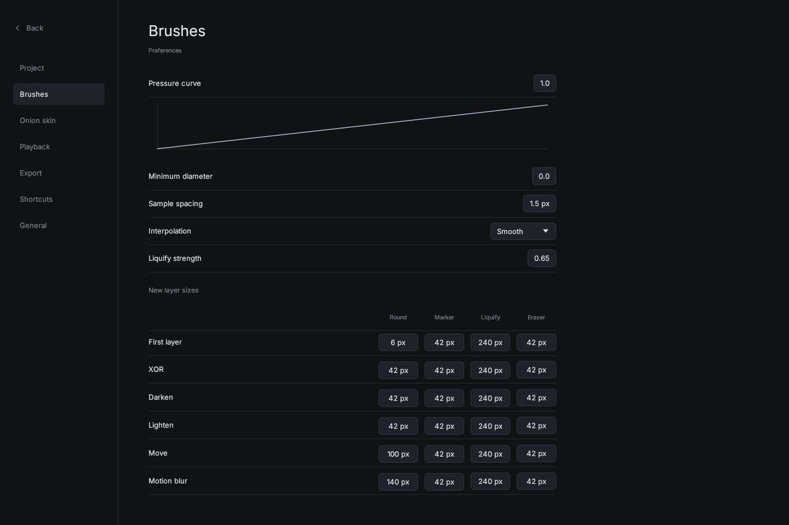
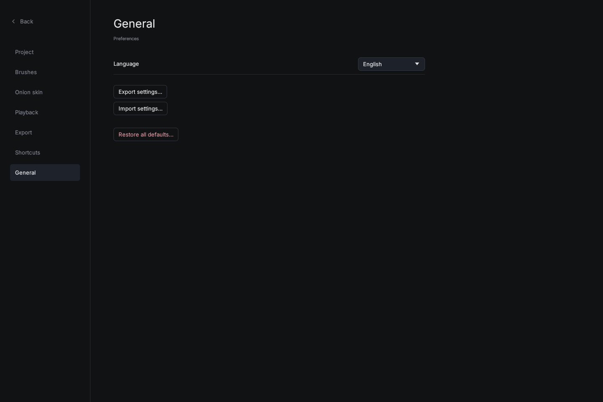

# MORI

English · [简体中文](README.zh-CN.md)

**MORI is minimalist animation software for macOS, Windows and Linux, built in Rust.**

**Move with rhythm.** Draw a picture, choose when it changes, and let it move with the music. MORI keeps the idea simple: **brushes, time, layers**.


## Brushes

Hold the right mouse button to open the brush wheel. Move toward an icon and release to choose it; release in the center to keep your current brush. The five tools have equal space on the wheel:

- **Round** draws a hard round line. Pressure changes its size.
- **Marker** draws with a flat rectangular tip. Pen tilt turns the tip; pressure changes its size.
- **Liquify** pushes existing lines around without changing their thickness.
- **Eraser** removes an entire stroke when you touch it, including when you move quickly.
- **Fill** paints the whole layer black, extending beyond the page. Moving the layers above it keeps the background black.

You can tap to make a dot, or press harder without moving to grow it. A mouse works at full pressure. Each layer remembers its chosen brush and a separate size for each adjustable brush. The second layer starts with Marker.



Brush settings let you adjust pressure, smoothness and default sizes. **Sample spacing** is the distance between points used to build a line: smaller values use more points. The default smooth setting rounds out quick gestures. Liquify starts with a larger brush. Onion skin shows three earlier and three later drawings, with distant drawings fading away.

## Time

**P1** gives you a canvas fitted to the window, with no permanent controls over the drawing. The normal system title bar stays available.

**P2** brings together the picture, music, beats and layer tracks. Click the audio area or drop in a file to import music. WAV, MP3, FLAC, OGG, AAC and M4A are supported.


Click or drag across the timeline to move through time. The playhead snaps to the beat grid while you drag. Hovering highlights the track and previews the grid position; hovering a frame's small diamond highlights its handle. Drag that handle to move the frame. Dropping it on another frame swaps them.

Scroll to pan. Pinch, or hold Command / Ctrl while scrolling, to zoom around the pointer. Middle-button dragging also pans. Playback follows the playhead by default. You can turn this off in **Playback**. Pausing normally returns both the playhead and the timeline view to where playback began; **Keep playhead** keeps your current place instead.

Double-click the tempo lane to add a BPM point. Right-click a point to set its BPM, **Division**, bars per group and beats per bar. Division is the number of steps in one beat: the default **8** gives eight positions per beat. Each point has its own setting; new points inherit the previous point's values. Changing the beat grid moves drawings to the nearest step. If two frames would overlap on one layer, later frames move forward to the next free steps.

A layer keeps showing its last drawing until you change it. At a new time, Round, Marker or Fill starts a new drawing. Liquify and Eraser start from the previous drawing. If you erase every stroke in a frame, that frame disappears and the previous drawing continues. Undo and redo let you revisit your edits without a fixed step limit.

## Layers

New projects have a widescreen 2.39:1 page and four layers. Click a layer name to select it, drag its name to reorder it, or right-click for its name, blending mode and available visual styles. There is always at least one drawing layer.

| Mode | What it does |
| --- | --- |
| XOR | Black on white; overlapping black marks turn white. This is the default for drawing layers. |
| Darken / Lighten | Keeps the darker or lighter parts of the combined pictures. |
| Move | One stroke moves everything below it by the distance from its start to its end. A new stroke replaces the previous one. Its cursor is a move symbol for every brush. |
| Motion blur | Blurs the picture below only where you paint, along the direction of your strokes. |

Move and Motion blur include Essential, Staccato echoes, Chromatic prism and Neon ribbons styles, with color in the latter two. Strokes continue beyond the page edges, so a dot on an edge can move into view as a complete dot. The page is cropped only for the final picture.

The small rhythm blocks at the bottom right show the current beat. The default is two rows of four blocks: one turns black each beat and the group resets after two bars. A BPM point's bars and beats determine the arrangement. The blocks sit beneath your layers, so your drawing and effects also affect them. Turn them off for this project, or change their default for new projects, in **Project** settings.

## Settings and files

Open Settings from the macOS application menu or with Command / Ctrl + comma; **Back** returns to your workspace. Option / Alt + 1 and 2 switch workspaces. All shortcuts are listed and editable in **Shortcuts**, including drawing size, time, layers, playback, saving and undo. Undo and redo default to Command + Z and Command + Shift + Z, with Ctrl on Windows and Linux.



The interface follows the system language, with English and Simplified Chinese available. **General** lets you choose a language, export or import your settings, or restore all defaults.

Application preferences save automatically: language, shortcuts, brushes, onion skin, playback options, new-project defaults and video quality. Each project keeps its own drawings, selected brushes, layer sizes and order, beat grid, music, page shape and rhythm blocks. Opening a project or undoing a drawing keeps your application preferences.

**Picture offset** adjusts local music playback alignment. It defaults to **−64 ms**; negative values advance the picture and positive values delay it. It leaves the timing of exported video unchanged.

The macOS **File** menu offers New project, Save, Save as and Export video. Projects use `.mori` files and include the original music. Export defaults to 1920 pixels wide, 60 FPS, H.264 MP4 and AAC audio. Drawings hold until their next change, with no blending between frames. Onion skin, the cursor and mirror assistance stay out of the video. FFmpeg is required for video export.

## Run

Requires Rust 1.92 or later and an OpenGL-capable desktop.

```sh
./scripts/run.sh
./scripts/run.sh --demo
./scripts/run.sh project.mori
```

On macOS, `./scripts/bundle-macos.sh` builds `target/MORI.app` for your Mac's architecture. Install FFmpeg with `brew install ffmpeg`.

On Linux:

```sh
sudo apt install build-essential pkg-config libasound2-dev libxkbcommon-dev libwayland-dev libgl1-mesa-dev
cargo run --release --locked
```

Linux file dialogs use your desktop's XDG Desktop Portal backend. On Windows, use the same Cargo command and put FFmpeg on PATH.

## Development

```sh
cargo fmt --check
cargo clippy --locked --all-targets -- -D warnings
cargo test --locked
cargo build --release --locked
# Requires a display and FFmpeg; on headless Linux, prefix with xvfb-run -a
./target/release/mori --smoke artifacts/gpu
```

Desktop tests in `scripts/ui-*-smoke.py` use Pillow, xdotool and a 1440 × 960 display. The audio-drop test also uses python3-xlib. Screenshots come from the running application. Tests can use `MORI_PREFERENCES_PATH` to keep settings separate.

Validation runs locally on Linux, with Apple Silicon compilation checks for native macOS modules. Huion hardware, native menus and audio alignment still need testing on a Mac.

Fonts: [Inter](https://rsms.me/inter/) ([license](assets/fonts/OFL.txt)) and [Noto Sans CJK SC](https://github.com/notofonts/noto-cjk) ([license](assets/fonts/NotoSansSC-LICENSE.txt)).
