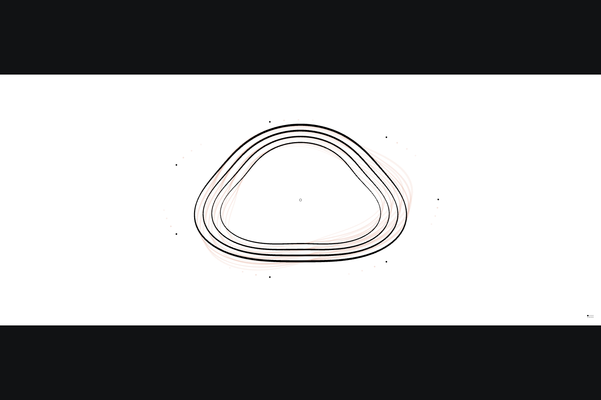
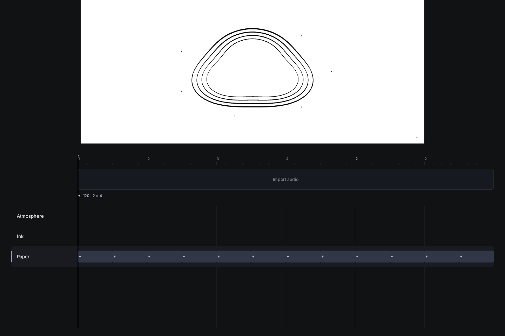

# MORI

English · [简体中文](README.zh-CN.md)

**MORI is minimalist animation software built in Rust for macOS, Windows and Linux.**

**Move with rhythm.** The name comes from **MO**ve with **R**hythm: draw, time exposures and shape motion around music.

Pressure-sensitive vector brushes, a musical timeline with variable BPM, and layers that also act as effects. A quiet canvas for drawing; a second workspace for rhythm and layers.



## Run

Requires Rust 1.92 or later and an OpenGL-capable desktop.

```sh
./scripts/run.sh
./scripts/run.sh --demo
./scripts/run.sh project.mori
```

On macOS, build for the host Apple Silicon or Intel architecture. `./scripts/bundle-macos.sh` produces `target/MORI.app`. Install FFmpeg for video export with `brew install ffmpeg`; MORI also checks Homebrew's installation paths.

On Linux:

```sh
sudo apt install build-essential pkg-config libasound2-dev libxkbcommon-dev libwayland-dev libgl1-mesa-dev
cargo run --release --locked
```

Linux file dialogs use your desktop's XDG Desktop Portal backend. On Windows, use the same Cargo command and make FFmpeg available on PATH.

## Two workspaces

**P1 — Canvas.** The paper fills the available window at the project's aspect ratio. The brush cursor and a temporary right-button brush wheel are the only drawing controls. The operating system's title bar stays available; fullscreen is your choice.

Hold the right button, move toward an icon and release: up for Round, lower right for Marker, lower left for the Liquify droplet, down for Eraser. Release in the center to keep the current brush.

**P2 — Rhythm and layers.** A preview, audio waveform, tempo starts and layer tracks. Click an empty audio area or drop a file onto it to import music. Right-click to replace or remove it.



- Playback follows the playhead by default when the timeline is zoomed in. Disable **Playback → Follow playback** to keep the viewport fixed; this preference is saved globally.
- Click the ruler or tracks to select time. Scroll to pan, pinch or Command / Ctrl + scroll to zoom around the pointer, or drag with the middle button to pan.
- Double-click the tempo lane to add a start. Drag it to move it; right-click to edit its BPM, time, bars per group and beats per bar. New starts inherit the preceding marker's settings; the first defaults to 2 × 4. The ruler distinguishes beats, bars and groups.
- Click a layer name to select it; drag it to reorder. Right-click for creation, renaming, visibility, blending, inversion, effects and exposure controls.
- Drag an exposure to move it to a musical grid point. Dropping onto an occupied point swaps the two exposures.

Default workspace shortcuts are Option / Alt + 1 and 2; Settings is Command / Ctrl + comma. All shortcuts can be viewed and changed in **Settings → Shortcuts**. Undo and redo default to Command + Z and Command + Shift + Z on macOS, Ctrl + Z and Ctrl + Shift + Z elsewhere. Existing custom bindings are retained.

On macOS, the system application menu includes **Settings…** and its shortcut. The native **File** menu provides New project, Save, Save as and Export video, using the same configurable shortcuts and save confirmation as the workspace. Settings has a **Back** control that returns to the previous workspace.

## Vector drawing

Round and Marker draw black on white, with pressure controlling diameter. Marker has a hard 4:1 rectangular tip whose orientation follows pen tilt. Without tilt input it stays horizontal. The cursor uses the same shape as the stroke.

A tap immediately leaves a mark. Increasing pressure while stationary grows the mark continuously; releasing pressure preserves the ink already drawn. A mouse uses full pressure. macOS reads floating-point pressure and tilt through typed AppKit events using `objc2` and `block2`.

Eraser removes every whole stroke touched by its circular footprint on the selected layer, including rapid pointer sweeps. Erasing held content creates a copy at the current time, preserving earlier exposures. Each gesture is one undo step; a miss creates no exposure or undo entry.

Each layer remembers a separate size for Round, Marker, Liquify and Eraser. Default sizes for new layers are global preferences, with a larger 240 px Liquify brush. Minimum diameter defaults to zero. Onion skin defaults to three previous and three following exposures, fading with distance.


**Sample spacing** is the maximum distance, in canvas pixels, between generated vector points; the default is 1.5 px. Smaller spacing produces more points. Smooth interpolation uses centripetal Catmull–Rom curves with continuous tangents. Original positions and pressure are retained, and only the newest curve segments are rebuilt as you draw. Linear interpolation is also available.

The first drawing stroke at a new time starts a blank exposure. A first Liquify stroke copies the preceding content and deforms vector positions while preserving pressure. Layers without a new exposure hold their previous content. A blank exposure interrupts that hold; removing it restores the hold. Undo and redo have no fixed step limit; unchanged vector data is shared through `Arc`.

## Musical time and effects

The timeline starts at 120 BPM with a 1/8-beat grid and supports multiple tempo starts. The selected canvas time always lies on the grid. Changing BPM, start times or grid density snaps every exposure to the nearest point. Collisions shift later exposures forward in their original order. Continuous tempo edits recalculate from the pre-edit exposures to avoid accumulated drift.

WAV, MP3, FLAC, OGG, AAC and M4A are supported. Audio playback follows the device's playback timestamps, including output latency. Playback without audio uses a monotonic clock.

**Playback → Picture offset** accepts positive and negative milliseconds and defaults to **−64 ms**. Positive values delay the picture; negative values advance it. This is a local audio playback calibration and leaves project timing and exports unchanged. Pausing defaults to returning to the playback start; **Keep playhead** pauses at the current grid point instead.

New projects use a 2.39:1 canvas and four drawable layers: Paper / XOR, Ink / XOR, Movement and Atmosphere / Motion blur. Every drawable layer can be reordered and its mode changed. A virtual white layer beneath them contains the optional rhythm watermark.

| Mode | Behavior |
| --- | --- |
| XOR | White is neutral; overlapping black areas turn white. |
| Darken / Lighten | Per-channel darker or lighter compositing. |
| Move | Keeps one stroke; its start-to-end displacement moves all lower content. |
| Motion blur | Keeps all strokes; applies directional shutter sampling only within their brush coverage. |

Local blur follows each stroke segment's tangent. Pressure controls coverage and local blur distance; layer amount scales the effect. Later strokes take precedence where strokes overlap. Inversion and styles respect the same local mask. Move and Motion blur offer Essential, Staccato echoes, Chromatic prism and Neon ribbons styles; Prism and Ribbons can introduce color.

The rhythm watermark sits at the virtual bottom, so painting, XOR, inversion, movement and blur affect it. Its default 2 × 4 arrangement shows two bars of four beats: one cell turns black each beat, future beats are light gray, and the group resets after two bars. Each tempo start controls this grouping. Toggle it for the current project or set the default for future projects. Cells and spacing use integer pixels; at 1920 px wide the initial cells are 5 × 5 px, with 2 px gaps and 24 px margins.

## Settings, saving and export

The interface follows the system language by default, using Simplified Chinese or English. Other system languages use English. **General → Language** offers Follow system, English and 简体中文; changes take effect immediately and persist globally.

**General** also exports all application preferences to JSON, imports a settings file, and restores all defaults after confirmation. Importing or resetting preferences leaves the current project and its undo history intact.


| Global preferences, saved automatically | Project data, saved in `.mori` |
| --- | --- |
| Language, shortcuts, picture offset, pause behavior, timeline follow | Canvas aspect, music, tempo starts and beat grouping |
| Onion skin, pressure curve, sampling, interpolation, Liquify strength | Current grid, duration, watermark toggle |
| New-project defaults and per-brush default sizes | Layer order, modes, inversion, styles, effect amount |
| Export width, FPS, CRF and audio toggle | Per-layer brush sizes, strokes, exposures, export range |

Opening or creating a project and undoing edits leave global preferences intact. Older projects retain their drawing sizes and receive defaults for missing brush sizes. Preferences live at:

- macOS: `~/Library/Application Support/MORI/preferences.json`
- Linux: `$XDG_CONFIG_HOME/MORI/preferences.json`, defaulting to `~/.config/MORI/preferences.json`
- Windows: `%APPDATA%/MORI/preferences.json`

`MORI_PREFERENCES_PATH` selects an isolated location for tests.

Projects are ZIP files containing `document.json` and the original audio, saved by atomic replacement. Video export defaults to H.264 / MP4, 60 FPS, CRF 18 and AAC audio. Output samples and holds the applicable exposure without frame blending, using the same GPU compositor at the requested resolution. Onion skin, mirror assistance, cursors and local picture offset stay out of the exported video. Export uses an independent snapshot and can be cancelled while preserving an existing destination file.

## Development checks

```sh
cargo fmt --check
cargo clippy --locked --all-targets -- -D warnings
cargo test --locked
cargo build --release --locked
# Requires a graphical environment and FFmpeg
./target/release/mori --smoke artifacts/gpu
# Linux without a display
xvfb-run -a ./target/release/mori --smoke artifacts/gpu
```

Desktop checks require Pillow and xdotool; the file-drop check also requires python3-xlib:

```sh
MORI_BINARY=target/release/mori xvfb-run -a -s '-screen 0 1440x960x24' python3 scripts/ui-smoke.py
MORI_BINARY=target/release/mori xvfb-run -a -s '-screen 0 1440x960x24' python3 scripts/ui-language-smoke.py
MORI_BINARY=target/release/mori xvfb-run -a -s '-screen 0 1440x960x24' python3 scripts/ui-erase-follow-smoke.py
MORI_BINARY=target/release/mori xvfb-run -a -s '-screen 0 1440x960x24' python3 scripts/ui-drop-smoke.py
```

Checks cover musical grids, exposure rules, Liquify, stationary pressure, incremental geometry, independent brush sizes, preferences, language switching and settings transfer. GPU checks exercise local blur coverage, direction, pressure, inversion and styles, and export an actual video with audio. Desktop checks capture the running app in `artifacts/ui`; the README images are actual application screenshots.

Validation currently runs locally on Linux. The native tablet and menu modules also receive Apple Silicon cross-compilation and Clippy checks. Native macOS menu interaction, physical Huion input, end-to-end audio sync and frame rates on the target Mac still require hardware validation.

Fonts: [Inter](https://rsms.me/inter/) under its [OFL license](assets/fonts/OFL.txt), and a glyph subset of [Noto Sans CJK SC](https://github.com/notofonts/noto-cjk) under its [OFL license](assets/fonts/NotoSansSC-LICENSE.txt).
