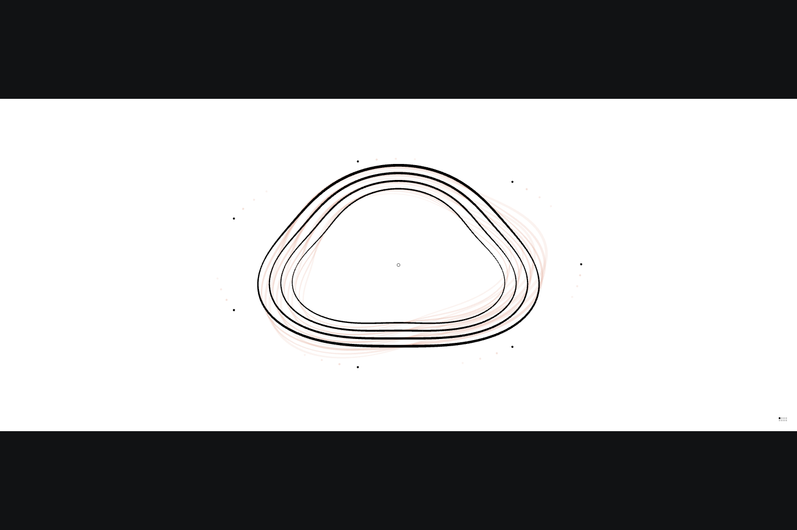
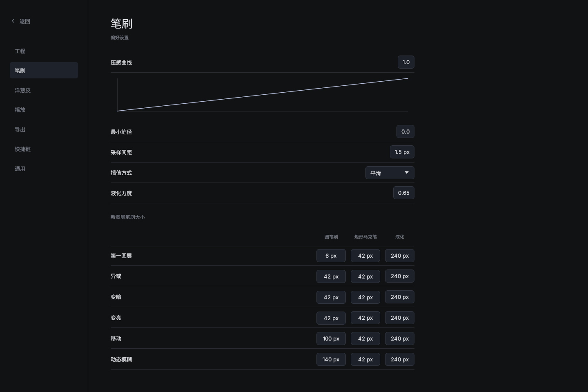

# MORI

[English](README.md) · 简体中文

**MORI 是一款用 Rust 构建的跨平台极简主义动画软件。**

**MORI — Move with rhythm.** 名字来自 MOve with Rhythm：让绘制、曝光和图层效果跟着音乐的节奏运动。

圆笔刷、矩形马克笔与液化，配合音乐原生时间、多图层和局部效果。



## 运行

需要 Rust 1.92+。支持 macOS、Windows、Linux；macOS 按本机 Apple Silicon / Intel 架构构建。

```sh
./scripts/run.sh
# 示例工程
./scripts/run.sh --demo
# 打开工程
./scripts/run.sh project.mori
```

macOS 应用打包：`./scripts/bundle-macos.sh`，输出 `target/MORI.app`。视频导出使用 FFmpeg，macOS 可安装 `brew install ffmpeg`；应用也会识别 Homebrew 的安装路径。

Linux 构建依赖：

```sh
sudo apt install build-essential pkg-config libasound2-dev libxkbcommon-dev libwayland-dev libgl1-mesa-dev
cargo run --release --locked
```

Linux 文件对话框需要桌面环境的 XDG Desktop Portal 后端。Windows 使用相同 Cargo 命令，导出时需让 FFmpeg 可执行文件出现在 PATH。

## 工作区

P1 只有画纸和笔刷光标，按项目比例占满窗口可用尺寸。没有菜单、工具栏、页脚、标签、快捷键提示或常驻状态文字。保留操作系统提供的标题栏；全屏由用户自行进入。画纸始终按工程比例自动适合窗口，不再提供多余的 Fit 快捷键。按住右键显示笔刷盘，朝上松开选择圆笔刷，朝右下松开选择矩形马克笔，朝左下松开选择液化。盘内只用三种简要矢量图标提示类型，中心松开保持当前笔刷。


P2 只保留画面预览、波形、节拍起始点与图层轨道：

- 空音轨显示 Import audio，可单击导入，也可拖入音频文件；悬停和拖入时会高亮，右键可替换或移除音乐。
- 时间尺与轨道单击定位。滚动平移时间，捏合或 Command / Ctrl + 滚轮缩放，中键拖动平移；缩放以指针位置为中心。
- 节拍区双击增加起始点，也可使用时间轴右键菜单。拖动起始点调整时间，右键编辑 BPM、时间、每组小节数与每小节拍数，或删除标记。新标记继承前一个标记的配置，首次默认为 2 × 4。时间尺区分拍、小节和分组边界。
- 单击图层名选层，拖动图层名调整顺序。所有可见图层都可以改混合模式、重排；至少保留一个可绘制图层。
- 图层右键菜单集中提供创建、重命名、可见性、混合模式、反色、效果力度与风格、空白曝光、删除曝光和删除图层。

页面切换、绘制、播放、保存等快捷键统一在设置的 **Shortcuts** 中查看、修改和恢复默认，其他页面不显示快捷键说明。打开、新建、另存为、导入音乐、导出也都有可配置的快捷键入口。笔刷通过右键盘选择，不占用快捷键。

拖动曝光条可移动该帧，目标自动吸附到音乐格点，拖动时显示目标位置。拖到已有帧则交换两帧位置。

设置页按工程、笔刷、洋葱皮、播放、导出、快捷键、通用分区，采用单列属性行；左上角 Back 返回进入设置前的工作区。应用内部固定使用统一深色主题，下拉菜单、输入框的展开与选中态不随系统浅色主题切回白底。没有宣传文案、装饰卡片和重复导航。

界面默认跟随系统语言，支持简体中文和英文；其他系统语言使用英文。在 **通用 → 语言** 中可以选择 English、简体中文或跟随系统，切换立即生效并全局保存。macOS 系统应用菜单提供 **设置… / Settings…**，默认快捷键 ⌘,。撤回、重做默认使用 ⌘Z、⌘⇧Z，Windows / Linux 对应 Ctrl；已有自定义快捷键保留。



## 矢量笔刷与曝光

每个图层分别保存圆笔刷、矩形马克笔和液化笔刷的当前尺寸。切换工具、切换图层会恢复对应尺寸；调整其中一个不会改变另一个。液化默认 240 px。各混合模式的新图层默认笔宽，可在 Brushes 的 Round / Marker / Liquify 三列永久配置；只影响之后创建的图层和工程。

`Sample spacing` 是生成矢量采样点之间的最大距离，单位是画板像素，默认 1.5 px；减小会增加点数。Smooth 使用向心 Catmull–Rom 曲线，相邻段切线连续，原始输入位置与压力保留。新输入只修正最近的曲线尾段，笔尖预览立即到达当前位置。Linear 保持直线插值。

鼠标使用满压力；数位笔保留系统浮点压力。轻点立即成点，原地加压连续扩大已经画出的范围，松压保留墨迹。压力曲线、最小笔径、采样间距、插值和液化力度属于全局偏好。新默认最小笔径为 0；洋葱皮默认前后各 3 帧，距离越远透明度越低。已经保存的偏好设置继续保留。

普通笔刷在新时刻的第一笔创建空白曝光；液化第一笔复制此前内容，再变形矢量位置，保留压力。没有曝光时逐层延续此前内容。空白曝光中断延续，删除曝光恢复延续。撤回、重做没有固定步数上限，未改动矢量由 Arc 共享。

矩形马克笔是长宽比 4:1 的硬边矩形，读取数位笔的 tilt 方位旋转笔尖，压力控制尺寸；预览和矢量几何共用同一矩形定义，倾斜方向保存在工程中。无 tilt 输入时为水平矩形。

macOS 通过类型化 AppKit 事件读取压感和倾斜。TabletProximity 只读取进入 / 离开状态，TabletPoint 读取压力；鼠标事件按其子类型处理。事件监视器不拦截正常指针事件。原生接入使用 `objc2` / `block2`。

## 音乐与效果

支持 WAV / MP3 / FLAC / OGG / AAC / M4A。播放由声卡实际播放时间戳驱动，并计入输出延迟；无音乐时使用单调时钟。画面在曝光时间戳生效，P1 选中时间保持在音乐格点上。

Playback 的 **Picture offset** 可正可负：正数延后画面，负数提前画面，单位毫秒，新默认 −64 ms。它是本机播放校准，只在有音轨的播放中生效，不改变工程曝光或导出文件的时间。

Playback 的 **On pause** 默认 Return to start：暂停返回本次开始播放的格点。Keep playhead 则停在当前播放位置对应的格点。这项偏好全局保存，手动改时间、编辑 BPM 等操作引起的停止维持原有行为。

默认 120 BPM、1/8 拍格点，支持多个 BPM 起始点。编辑 BPM、起始点或格点步长后，全部曝光自动吸附到最近格点；冲突帧按原先后顺序逐格顺延，不合并、不覆盖。连续拖动 BPM 时从编辑前的曝光重新计算，避免累计漂移；需要时延长工程时长。旧工程加载时也会对齐。

新工程默认 2.39:1，可见图层依次为 Paper / XOR、Ink / XOR、Movement、Atmosphere / Motion blur。可见的第一层默认较细，但行为与其他绘制层一致。所有可见图层下面另有固定的虚拟底层：开启节奏水印时包含水印，关闭时只有纯白；上面的 XOR、反色、移动和局部模糊都会作用于它。

| 模式 | 行为 |
| --- | --- |
| XOR | 白色为中性值，黑色重叠部分变白 |
| Darken / Lighten | 对图层画纸逐通道取暗 / 取亮 |
| Move | 唯一只保留一条轨迹的模式；根据首尾差移动全部下层画面 |
| Motion blur | 保留所有轨迹，只在笔刷覆盖区对下层画面做方向性快门积分 |

局部模糊使用每段轨迹的切向方向，压力决定笔刷覆盖范围与局部模糊距离，图层力度统一调节效果。弯曲轨迹的模糊方向随路径变化；多条轨迹合成同一局部方向场，重叠处由后画的轨迹覆盖。范围外像素保持不变，反色与风格效果也遵守覆盖范围。这里没有使用高斯模糊。

移动和模糊均提供 Essential、Staccato echoes、Chromatic prism、Neon ribbons 四种风格；后两者可产生颜色。

## 节奏水印

工程默认开启右下角的节奏方块。每个 BPM 段的 `bars × beats` 同时决定分组与排列：默认 2 行 × 4 列，一组两小节、每小节四拍。按行从左到右，每到一拍对应方块变黑，尚未到达的方块为浅灰，两小节结束后重新开始；拍内的格点细分不影响水印。

Project 设置可独立关闭当前工程的水印，New projects 开关控制未来新工程默认是否显示。开关随各自范围保存。水印位于虚拟底层，可被上层绘画和效果处理；没有水印时虚拟底层为纯白。

在 1920 像素宽度下，初始方块为 5 × 5 像素、间距 2 像素、右侧和下侧留白 24 像素；其他尺寸采用整数像素重算。方块无抗锯齿边缘，预览和导出按各自实际像素计算，整数对齐。图层的移动、模糊等效果照常可以改变水印的最终形态。

## 保存范围

| 全局偏好，编辑后自动持久化 | 工程本地，随 `.mori` 保存 |
| --- | --- |
| 洋葱皮、压力曲线、采样、插值、液化力度 | 画纸比例、音轨、BPM、节拍分组、水印开关、当前格点步长与时长 |
| 语言、所有快捷键、音画偏移与暂停行为 | 图层顺序、混合模式、反色、风格、力度 |
| 新工程默认比例、步长、水印开关，新图层每种笔刷默认尺寸 | 每层每种笔刷的当前尺寸、矢量轨迹和曝光 |
| 导出宽度、FPS、CRF、音频开关 | 导出起止时间 |

**通用** 中可以导出全部全局偏好为 JSON、导入设置文件，或确认后全部恢复默认。导入和重置立即保存，不改变当前工程内容或撤回历史；工程本地设置继续随工程保存。


打开工程、新建工程和撤回不会覆盖全局偏好。旧工程内的偏好字段会被忽略，旧图层的普通笔宽保留，缺失的液化笔宽初始为 240 px。

偏好位置：macOS `~/Library/Application Support/MORI/preferences.json`；Linux `$XDG_CONFIG_HOME/MORI/preferences.json`（默认 `~/.config`）；Windows `%APPDATA%/MORI/preferences.json`。测试可用 `MORI_PREFERENCES_PATH` 指定隔离文件。

工程是包含 `document.json` 和原始音乐的 ZIP，原子替换保存。视频默认 H.264 / MP4、60 FPS、CRF 18、AAC；每个输出时间取样对应曝光并保持，无帧混合。画面按输出分辨率进行同一套 GPU 合成。洋葱皮、镜像辅助、光标和本机音画校准不写入视频。导出使用独立快照，可取消，取消保留已有目标文件。

## 验证

```sh
cargo fmt --check
cargo clippy --locked --all-targets -- -D warnings
cargo test --locked
# 需要图形环境与 FFmpeg
cargo run --release --locked -- --smoke artifacts/gpu
# Linux 无显示器
xvfb-run -a cargo run --release --locked -- --smoke artifacts/gpu
# 桌面交互、截图及偏好重启测试，需要 Pillow / xdotool
MORI_BINARY=target/release/mori xvfb-run -a -s '-screen 0 1440x960x24' python3 scripts/ui-smoke.py
# 系统语言、语言切换、重启持久化与全局重置
MORI_BINARY=target/release/mori xvfb-run -a -s '-screen 0 1440x960x24' python3 scripts/ui-language-smoke.py
# 真实音频文件拖入
MORI_BINARY=target/release/mori xvfb-run -a -s '-screen 0 1440x960x24' python3 scripts/ui-drop-smoke.py
```

测试覆盖曝光规则、音乐格点、矢量液化、原地压力、增量网格、笔宽独立性、全局偏好与工程隔离，以及数位笔事件的合法属性访问。GPU 检查覆盖局部模糊的区域外像素、多轨迹、反色、风格、方向、压力，并实际导出含音轨的视频。

自动运行环境为 Linux；数位笔接入模块另通过 Apple Silicon 目标编译与 Clippy 检查。原生 macOS 菜单、真实 Huion、声卡端到端同步和目标 Mac 上的帧率需在实机验证。

`scripts/ui-drop-smoke.py` 通过真实 Xdnd 文件拖放协议验证导入音频、解码、波形和悬停反馈，需要额外安装 `python3-xlib`。

截图取自实际运行的应用；桌面测试生成截图至 `artifacts/ui`。当前验证在本地运行。

字体使用 [Inter](https://rsms.me/inter/) 和 [Noto Sans CJK SC](https://github.com/notofonts/noto-cjk) 的字形子集，分别遵循 [Inter OFL](assets/fonts/OFL.txt) 和 [Noto OFL](assets/fonts/NotoSansSC-LICENSE.txt)。
