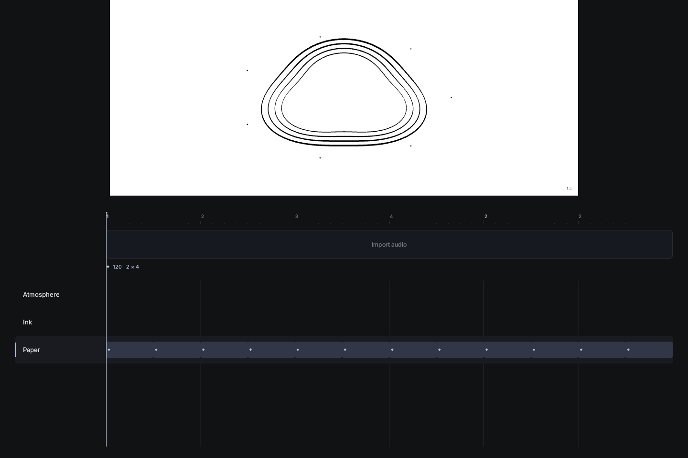
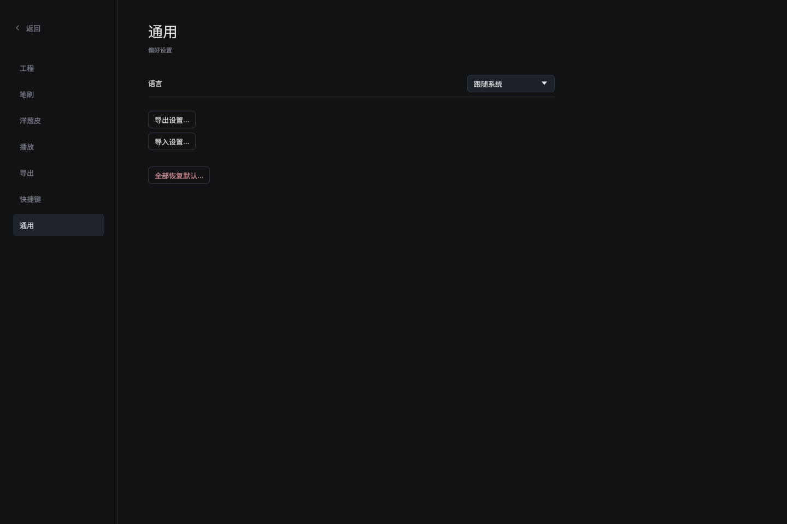

# MORI

[English](README.md) · 简体中文

**MORI 是一款用 Rust 构建的跨平台极简主义动画软件，支持 macOS、Windows 和 Linux。**

**Move with rhythm，跟着节奏动起来。** 画一张图，决定它什么时候变化，让画面跟随音乐。只需要理解三件事：**笔刷、时间、图层**。


## 笔刷

按住鼠标右键打开笔刷盘，朝图标移动后松开即可选择；在中心松开则保留当前笔刷。五种工具在盘上均匀排列，占据相同面积：

- **圆笔刷**：硬边圆形笔尖，压力控制大小。
- **马克笔**：扁平矩形笔尖，数位笔的倾斜方向控制朝向，压力控制大小。
- **液化**：推动已有线条，保留原来的粗细。
- **橡皮擦**：碰到一条笔迹就擦掉整条，快速划过也能擦到。
- **油漆桶**：将整层涂黑；它作为一条笔迹保存，橡皮擦碰到即可整条擦除。

轻点可以画出圆点，原地加压可以让圆点变大。鼠标以满压力绘制。每一层分别记住选中的笔刷，以及每种可调笔刷的大小。第二层默认使用马克笔。


设置中可以调整压感、线条平滑和默认大小。**采样间距**是生成线条时，相邻采样点之间的距离；越小，使用的点越多。默认平滑模式会让快速绘制的线条保持顺滑。液化默认使用较大的笔刷。洋葱皮默认显示前后三帧，越远越淡，方便对照相邻画面。

## 时间

**P1** 是绘画界面，画板按比例尽量占满窗口，没有常驻控件遮住画面。系统标题栏保持可用。

**P2** 把画面、音乐、节拍和图层轨道放在一起。点击音频区域或将文件拖进去即可导入音乐，支持 WAV、MP3、FLAC、OGG、AAC 和 M4A。



在时间轴上点击或拖动即可定位时间，拖动时播放头会实时吸附到节拍格点。悬停时，轨道会高亮并预览所在格点；移到帧头的小菱形上，则高亮拖动手柄。拖动帧头可以移动这一帧，拖到已有帧的位置会交换两帧。右键帧头可以复制到下一格，或删除这一帧；复制时若与已有帧重合，已有帧会往后顺延。删除后会继续显示上一帧。

滚动可以平移时间轴；捏合，或按住 Command / Ctrl 滚动，可以围绕鼠标缩放；中键拖动也可平移。播放时默认跟随播放头，可以在**播放**设置中关闭。暂停默认同时将播放头和时间轴视野恢复到开始播放时的位置；选择**停在当前位置**则保留当前进度和视野。

双击节拍区域可以增加 BPM 点。右键一个点，可以设置 BPM、**每拍细分**、每组小节数和每小节拍数。每拍细分默认 **8**，也就是一拍内有八个可定位的位置。每个 BPM 点各自设置，新点继承前一个点的数值。修改格点后，画面自动吸附到最近的位置；同层发生重叠时，后面的帧依次往后顺延。

每层会保持上一张图，直到你画出新内容。在新时间点使用圆笔刷、马克笔或油漆桶，会开始一张新图；使用液化或橡皮擦，则从之前的画面继续修改。擦掉一帧的所有笔迹后，会保留这个空帧。在 P1 按 Del 在当前位置创建空帧，按 Shift+D 将上一帧复制到当前位置，作为可独立修改的画面。撤回和重做没有固定步数限制。

## 图层

新工程使用 2.39:1 的宽银幕画板，默认四层。点击图层名称选层，拖动名称调整顺序；右键可以修改名称、混合模式和可用的视觉风格。至少保留一个绘画图层。

| 模式 | 效果 |
| --- | --- |
| 异或 | 白底黑画笔，黑色重叠部分变白；绘画图层默认使用此模式。 |
| 变暗 / 变亮 | 保留叠加画面中较暗或较亮的部分。 |
| 移动 | 用笔迹首尾的位移移动下方所有画面。只保留一笔，新笔替换旧笔；任何笔刷都显示移动光标。 |
| 动态模糊 | 只在涂到的地方，对下方画面沿笔迹方向产生运动模糊。 |

移动和模糊提供基础、断奏回声、色散棱镜和霓虹丝带等风格，后两种可以产生颜色。渲染范围为画板矩形，移动和动态模糊对这张画面进行采样。

右下角的小方块显示当前节拍。默认两行四列，每到一拍亮一块，两小节后重置；BPM 点的小节数和拍数决定排列方式。方块位于所有绘画层下面，也会受到绘画和效果影响。可以在**工程**设置中关闭当前工程的节奏方块，也可以修改新工程的默认开关。

## 设置与文件

通过 macOS 应用菜单或 Command / Ctrl + 逗号打开设置，点击**返回**回到之前的界面。Option / Alt + 1 和 2 切换工作区。笔刷大小、时间、图层、播放、保存和撤回等快捷键，都可以在**快捷键**设置中查看和修改。撤回、重做默认是 Command + Z、Command + Shift + Z；Windows 和 Linux 使用 Ctrl。



界面默认跟随系统语言，支持英文和简体中文。**通用**中可以切换语言、导入或导出设置，以及全部恢复默认。

应用偏好会自动保存，包括语言、快捷键、笔刷、洋葱皮、播放选项、新工程默认值和视频质量。每个工程各自保存画面、每层选中的笔刷和大小、图层顺序、节拍格点、音乐、画板比例和节奏方块。打开工程或撤回绘画不会覆盖应用偏好。

**画面偏移**用于校准本机音乐播放，默认 **−64 ms**；负数提前画面，正数延后画面，不改变导出视频的时间。

macOS 的**文件**菜单提供新建工程、保存、另存为和导出视频。工程使用 `.mori` 文件，包含原始音乐。视频默认宽 1920 像素、60 FPS、H.264 MP4 和 AAC 音频。每张图保持到下一次变化，不在帧间混合。洋葱皮、光标和镜像辅助不写入视频。视频导出需要 FFmpeg。

## 运行

需要 Rust 1.92 或以上，以及支持 OpenGL 的桌面环境。

```sh
./scripts/run.sh
./scripts/run.sh --demo
./scripts/run.sh project.mori
```

macOS 使用 `./scripts/bundle-macos.sh` 打包为 `target/MORI.app`，按本机架构构建。FFmpeg 可以通过 `brew install ffmpeg` 安装。

Linux：

```sh
sudo apt install build-essential pkg-config libasound2-dev libxkbcommon-dev libwayland-dev libgl1-mesa-dev
cargo run --release --locked
```

Linux 文件对话框需要桌面环境的 XDG Desktop Portal 后端。Windows 使用相同的 Cargo 命令，并将 FFmpeg 放到 PATH 中。

## 开发验证

矢量笔迹始终是原始数据。GPU 保留已渲染的图层和可见帧，绘制时更新受影响区域；只移动光标时直接复用已合成的洋葱皮画面。分辨率、采样和抗锯齿保持原有设置。

```sh
cargo fmt --check
cargo clippy --locked --all-targets -- -D warnings
cargo test --locked
cargo build --release --locked
# 需要显示环境和 FFmpeg；Linux 无显示器时加上 xvfb-run -a
./target/release/mori --smoke artifacts/gpu
```

`scripts/ui-*-smoke.py` 中的桌面测试使用 Pillow、xdotool 和 1440 × 960 的显示环境。音频拖入测试还使用 python3-xlib。截图来自实际运行的应用。测试可以通过 `MORI_PREFERENCES_PATH` 使用独立的设置文件。

排查本机帧率时，可以运行 `./scripts/run.sh --trace-frames` 并持续移动笔尖或鼠标。终端会输出实际帧间隔、CPU 提交耗时和 GPU 信息，不强制 GPU 同步。

目前在 Linux 本地验证，并对 macOS 原生模块进行 Apple Silicon 编译检查。Huion 数位屏、原生菜单和音画同步仍需在 Mac 上实测。

字体：[Inter](https://rsms.me/inter/)（[授权](assets/fonts/OFL.txt)）和 [Noto Sans CJK SC](https://github.com/notofonts/noto-cjk)（[授权](assets/fonts/NotoSansSC-LICENSE.txt)）。
